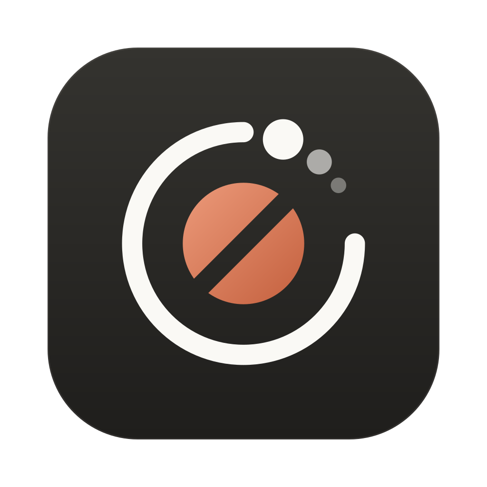
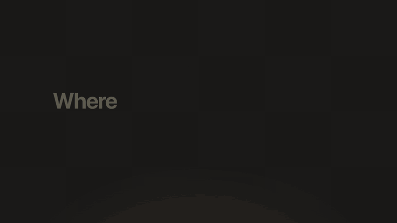

<p align="center">
  
</p>

<h1 align="center">Deskveet</h1>

<p align="center">
  A small, fast and private disk cleaner for your desktop.<br>
  It shows where your space went, cleans what is safe to clean, and only goes online to update itself.
</p>

<p align="center">
  <a href="https://github.com/vecvel/deskveet/releases/latest"></a>
  <a href="https://github.com/vecvel/deskveet/actions/workflows/release.yml"></a>
  
  
  
  
  
  
  <a href="LICENSE"></a>
</p>

<p align="center">
  
</p>

---

## Download

The latest version, straight from the [latest release](https://github.com/vecvel/deskveet/releases/latest). Each
release lists `SHA256SUMS.txt` to check the files against.

| Platform | For | Download |
|---|---|---|
|  | macOS 13 or later, Apple Silicon and Intel | [**Deskveet.dmg**](https://github.com/vecvel/deskveet/releases/latest/download/Deskveet-universal.dmg) · [app as .zip](https://github.com/vecvel/deskveet/releases/latest/download/Deskveet-universal.app.zip) |
|  | Windows 10 and 11, x64 | [**Installer**](https://github.com/vecvel/deskveet/releases/latest/download/Deskveet-x64-setup.exe) · [portable .zip](https://github.com/vecvel/deskveet/releases/latest/download/Deskveet-x64-portable.zip) |
|  | Windows 10 and 11, ARM | [**Installer**](https://github.com/vecvel/deskveet/releases/latest/download/Deskveet-arm64-setup.exe) · [portable .zip](https://github.com/vecvel/deskveet/releases/latest/download/Deskveet-arm64-portable.zip) |
|  | 64-bit Linux, x64 | [**AppImage**](https://github.com/vecvel/deskveet/releases/latest/download/Deskveet-amd64.AppImage) · [.deb](https://github.com/vecvel/deskveet/releases/latest/download/Deskveet-amd64.deb) |
|  | 64-bit Linux, ARM | [**AppImage**](https://github.com/vecvel/deskveet/releases/latest/download/Deskveet-arm64.AppImage) · [.deb](https://github.com/vecvel/deskveet/releases/latest/download/Deskveet-arm64.deb) |

## Why Deskveet

Most cleaners either do too little or ask you to trust them with everything. Deskveet sits in between. It knows
the folders that developer tools, browsers and apps fill up (Xcode, Android Studio, Gradle, npm, Cargo, Flutter,
Chrome, VS Code and many more), tells you what each one is and how it comes back, and only cleans after you have
seen the list. Anything it is not sure about, it leaves alone.

It is also light. The app is a few megabytes, idles at around 30 MB of memory with the window closed, and starts
in well under a second.

## What it does

- **Overview.** Disks, memory, CPU per core and the processes using the most. Live while you look at it, quiet
  when you don't.
- **Storage.** A fast parallel scan of any folder, sizes per folder, drill down, and a treemap you can scroll
  through so even the small folders get a label. Every item can be shown in your file manager, opened, copied
  or moved to the Trash or Recycle Bin.
- **Large and duplicate files.** Files over a size you pick that have not changed for months, and files with
  identical contents anywhere below a folder. Duplicates are compared by content, and the last copy of a file is
  never offered.
- **Cleanup.** Built-in rules for each system, written as plain files in [`rules/`](rules). Each rule explains
  what happens if you delete its items and how they come back. You always see a preview first, then confirm.
  There is a dry run, an undo log and a Restore button.
- **Custom rules.** Add your own (for example every `.dmg` or `.iso` in Downloads) with a live preview of what
  they match. Custom rules only ever move things to the Trash or Recycle Bin, and the same safety checks apply.
- **Tracking.** Size history per rule, an alert when something grows past a size you pick or the disk gets low,
  and optional daily or weekly cleaning of the safe rules.
- **Menu bar and system tray.** Free space, memory, the next scheduled clean and "Clean safe caches now" with the
  window closed. The same menu empties the bin, quits the heaviest app or all apps, keeps the computer awake,
  ejects drives, and locks, sleeps, restarts or shuts down.
- **Apps and processes.** The running apps with their memory and CPU, and a process list with Quit and Force
  Quit. System processes are never offered.
- **Uninstall, leftovers and startup items.** Remove apps, find the data that apps you already removed left
  behind, and see what starts when you log in.
- **Project artifacts.** `node_modules`, `target`, `build`, `.dart_tool`, `.gradle` and friends below folders you
  choose, grouped by project, with the idle ones easy to select.
- **Updates.** Deskveet keeps itself up to date in the background. Each update is checked against its signing key
  and used the next time it starts. It can be turned off in Settings.

## On each system

Deskveet is one app with the same screens on macOS, Windows and Linux. What changes is where it looks and the words it uses.

### Mac

- **Runs on** macOS 13 Ventura or later, Apple Silicon and Intel (one universal app, about 7 MB).
- **Rules:** 61 in [`rules/macos.toml`](rules/macos.toml): Xcode DerivedData, simulators, Homebrew, CocoaPods, Rust toolchains,
  browser and app caches, logs, and more.
- **Cleaned items** go to the Trash.
- **Lives in** the menu bar, with no Dock icon when the window is closed.
- **Apps:** uninstall removes an app together with its settings, caches and containers. Leftovers looks in your
  Library, and Startup lists launch agents and login items. Apple's own apps and data are never listed.
- **Also:** purgeable space and memory pressure in Overview, Quick Look previews, and APFS clones pointed out
  among duplicates. A few folders (Mail, some app containers) can only be measured with Full Disk Access; the app
  says when and opens the right settings page.

### Windows

- **Runs on** Windows 10 (22H2) and Windows 11, x64 and ARM64 (installer about 2 MB).
- **Rules:** 37 in [`rules/windows.toml`](rules/windows.toml): Temp, crash dumps, Windows error reports, shader
  cache, Chrome, Edge, Brave, Firefox, VS Code, Discord, Teams, Gradle, npm, NuGet, Visual Studio, and more.
- **Cleaned items** go to the Recycle Bin.
- **Lives in** the system tray, and starts at sign-in if you want it to.
- **Apps:** uninstall runs each app's own uninstaller. Leftovers looks in AppData, and Startup lists what starts
  when you sign in. Shared runtimes such as Visual C++, .NET and WebView2 are never offered.
- **Also:** installs for your account only, so it never needs an administrator.

### Linux

- **Runs on** 64-bit desktops such as Ubuntu 22.04, Debian 12, Fedora 38 and newer, x64 and ARM64, as an
  AppImage or a `.deb` package.
- **Rules** for `~/.cache`, thumbnails, browser and app caches, Flatpak and Snap leftovers, and the same developer
  tools as everywhere else: Gradle, npm, Yarn, pnpm, pip, Cargo, Go, Flutter and Android.
- **Cleaned items** go to the desktop's own Trash, so the file manager can put them back.
- **Lives in** the system tray, and starts when you log in if you want it to.
- **Apps:** Leftovers looks in `~/.config`, `~/.local/share` and `~/.cache`, and Startup lists the autostart
  entries in `~/.config/autostart`.
- **Also:** works on GNOME, KDE Plasma and other desktops, and never needs root.

## Safe by design

Nothing is touched unless it passes two checks on its real path, with links resolved.

1. **It was asked for.** Either a rule matched it, or you picked it yourself, and then it always goes to the
   Trash or Recycle Bin.
2. **It is not protected.** The blocklist always wins, on every system:
   - **Mac:** `/`, `/System`, `/usr`, `/Library`, your home folder, the roots of Desktop, Documents, Pictures,
     Movies and Music, iCloud Drive, the Photos and Music libraries, keychains, `~/.ssh`, `~/.gnupg`, Mail,
     Messages and Safari data.
   - **Windows:** every drive's root, `Windows`, `Program Files`, `ProgramData`, your profile and its top folders,
     AppData itself, saved credentials and encryption keys, OneDrive and the registry files.
   - **Linux:** `/`, `/usr`, `/etc`, `/boot`, `/var`, `/proc`, `/sys`, your home folder and its top folders,
     `~/.config` and `~/.local/share` themselves, and your keyrings.
   - **Everywhere:** every `.git` folder and your SSH and GPG keys.

Browsers that are running block their own cache rules, files that are open need an extra tick, and emptying the
Trash or Recycle Bin needs a second confirmation. Deskveet never asks for administrator rights. When a rule
needs them, it shows you the command to run yourself.

The checks live in [`src-tauri/src/safety.rs`](src-tauri/src/safety.rs) and are covered by tests that run against
temporary folders, never your own, on every system Deskveet supports.

## Private by default

Deskveet has no telemetry and no accounts. Its only connection is to GitHub, once a day, to check for a new
version and download it. Turn automatic updates off in Settings and it makes no connection at all. The window's
content security policy blocks every connection. Cleanup tools you choose to run, such as `brew` or `npm`, are
separate programs and behave as they always do. The full [privacy policy](PRIVACY.md) lists the few files
Deskveet keeps on your computer.

## Install

### Mac

Open the `.dmg` and drag Deskveet to Applications.

### Windows

Run `Deskveet-x64-setup.exe` (or `arm64` on an ARM PC). The installer is not code signed, so
SmartScreen may say "Windows protected your PC" the first time: choose **More info**, then **Run anyway**. The
portable zip runs from any folder without installing; it does not update itself.

### Linux

Make the AppImage executable and run it:

```bash
chmod +x Deskveet-amd64.AppImage
./Deskveet-amd64.AppImage
```

Or install the package on Debian and Ubuntu (`arm64` builds are there too):

```bash
sudo apt install ./Deskveet-amd64.deb
```

The AppImage updates itself. The `.deb` is updated by installing the newer package. The `.deb` is a few
megabytes and uses the system's web engine; the AppImage brings its own copy, so it runs on any distribution
and is larger.

## Build it yourself

You need Rust, Node.js and pnpm. On every system:

```bash
pnpm install
pnpm tauri dev                 # run in development
cd src-tauri && cargo test     # the test suite, all against temporary folders
scripts/icons.sh               # regenerate every icon from scripts/logo.py
```

### Mac

```bash
scripts/build.sh               # universal .app and .dmg (add --native for this Mac only)
```

`scripts/build.sh` signs with the best certificate it finds: a Developer ID Application certificate, then a
self-signed one called `Deskveet Development`, then ad-hoc. A stable signature matters because macOS ties Full
Disk Access to it. With an ad-hoc build the permission silently stops applying after every rebuild.

If you have no Developer ID, a free self-signed certificate works for your own builds:

1. Open Keychain Access, then Certificate Assistant, then Create a Certificate.
2. Name it `Deskveet Development`, Identity Type *Self-Signed Root*, Certificate Type *Code Signing*.
3. Build, then remove and re-add Deskveet once under Privacy & Security, Full Disk Access.

#### Fastlane

The same steps are available as [fastlane](https://fastlane.tools) lanes (`brew install fastlane`). Copy
`fastlane/.env.example` to `fastlane/.env` and fill in your App Store Connect API key first.

```bash
fastlane mac build            # universal app and disk image, both signed and notarised when the key is set
fastlane mac notarize_dmg     # notarise the newest disk image on its own
fastlane mac release          # tag the version and push it, GitHub Actions publishes the release
fastlane mac store_metadata   # upload the App Store text and the screenshots in assets/store-listing/mac-app-store
```

### Windows

```bash
pnpm tauri build               # the per-user setup .exe, in src-tauri/target/release/bundle/nsis
```

It needs the Visual Studio C++ build tools; WebView2 comes with Windows 10 and 11.

### Linux

```bash
pnpm tauri build               # the AppImage and the .deb, in src-tauri/target/release/bundle
```

It needs the WebKitGTK and GTK development packages; on Debian and Ubuntu, `libwebkit2gtk-4.1-dev`,
`libgtk-3-dev`, `libayatana-appindicator3-dev`, `librsvg2-dev` and `build-essential`.

### Releases

Pushing a tag like `v1.0.0` runs [the release workflow](.github/workflows/release.yml). It tests and builds every
system on its own runner, then publishes everything in one release with checksums and `latest.json`, which
installed copies read to update. It can also run from the Actions tab without publishing, to try the files first.

Every update is signed. The release stops unless these are set (the key comes from `pnpm tauri signer generate`;
keep a backup, because installed copies only accept updates signed with it):

| Secret | What it is |
|---|---|
| `TAURI_SIGNING_PRIVATE_KEY` | the private update signing key |
| `TAURI_SIGNING_PRIVATE_KEY_PASSWORD` | its password |

Mac signing and notarisation switch on when these are set too:

| Secret | What it is |
|---|---|
| `APPLE_CERTIFICATE` | the Developer ID Application certificate exported as `.p12`, base64 encoded |
| `APPLE_CERTIFICATE_PASSWORD` | the password you chose when exporting it |
| `APPLE_SIGNING_IDENTITY` | the certificate name, like `Developer ID Application: Name (TEAMID)` |
| `APPLE_API_KEY_ID` | App Store Connect API key ID |
| `APPLE_API_ISSUER` | the issuer ID from the App Store Connect keys page |
| `APPLE_API_KEY_P8` | the contents of the `AuthKey_XXXX.p8` file |

## How it is built

Rust and Tauri 2 for the engine, plain TypeScript for the interface (no framework, about 70 KB). The
operating system specific parts sit behind small traits in [`src-tauri/src/platform`](src-tauri/src/platform),
with one module and one rules file per system. The tests run on every supported system on every push.

| Measure | Figure |
|---|---|
| App size | a few megabytes on every system |
| Memory, window open | about 25 MB plus the system web view (WebKit, WebView2 or WebKitGTK) |
| Memory, window closed | about 30 MB; the window is released after it has been hidden for a while |
| Scanning 3.4 million files | about 36 MB at peak, around 40 seconds the first time and 15 seconds after (measured on a Mac) |

The styling is in [`src/styles`](src/styles), with every colour, size and radius in one file of tokens. The icon
is pure geometry: a planet with a wipe through it, inside an orbit that is open for one quarter, with dust leaving
through the gap. Every measure comes from one module on a 32 unit grid and the golden ratio. The numbers are in
[`scripts/logo.py`](scripts/logo.py).

## License

Deskveet is proprietary software. You are welcome to read the code, but you may not copy, modify or
redistribute it without written permission. See [LICENSE](LICENSE). Taking part in this project means following
the [code of conduct](CODE_OF_CONDUCT.md).

## Star history

<a href="https://star-history.com/#vecvel/deskveet&Date">
  <picture>
    <source media="(prefers-color-scheme: dark)" srcset="https://api.star-history.com/svg?repos=vecvel/deskveet&type=Date&theme=dark">
    
  </picture>
</a>
