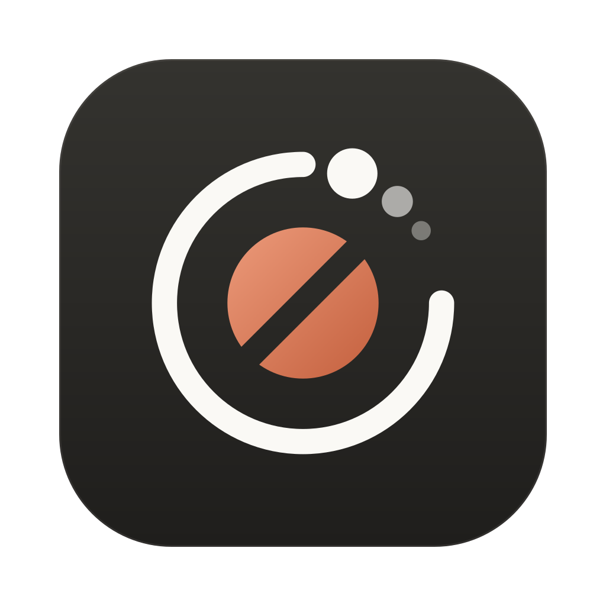
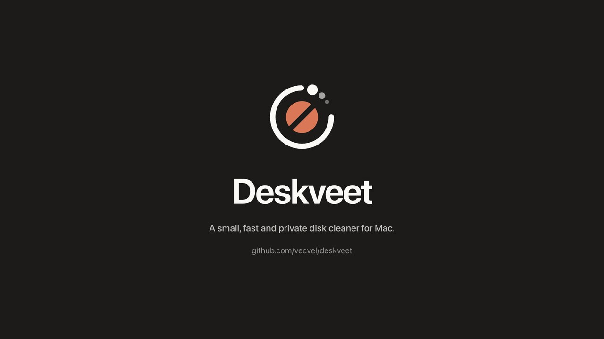

<p align="center">
  
</p>

<h1 align="center">Deskveet</h1>

<p align="center">
  A small, fast and private disk cleaner for the Mac.<br>
  It shows where your space went, cleans what is safe to clean, and never talks to the internet.
</p>

<p align="center">
  <a href="https://github.com/vecvel/deskveet/releases/latest"></a>
  <a href="https://github.com/vecvel/deskveet/actions/workflows/release.yml"></a>
  
  
  
  
  
  <a href="LICENSE"></a>
</p>

<p align="center">
  <a href="assets/deskveet-promo.mp4"></a><br>
  <sub>Deskveet in 20 seconds. Click the picture to play the video.</sub>
</p>

---

## Why Deskveet

Most cleaners either do too little or ask you to trust them with everything. Deskveet sits in between. It knows
the folders that developer tools, browsers and apps fill up (Xcode, simulators, Gradle, npm, Cargo, Flutter,
Homebrew and about fifty more), tells you what each one is and how it comes back, and only cleans after you have
seen the list. Anything it is not sure about, it leaves alone.

It is also light. The whole app is about 7 MB, idles at around 30 MB of memory with the window closed, and
starts in well under a second.

## What it does

- **Overview.** Disks (used, purgeable, free), memory and memory pressure, CPU per core and the processes using
  the most. Live while you look at it, quiet when you don't.
- **Storage.** A fast parallel scan of any folder, sizes per folder, drill down, and a treemap you can scroll
  through so even the small folders get a label. Every item can be revealed in Finder, opened, copied, previewed
  with Quick Look or moved to the Trash.
- **Cleanup.** 56 built-in rules in [`rules/macos.toml`](rules/macos.toml). Each one explains what happens if you
  delete its items and how they come back. You always see a preview first, then confirm. There is a dry run, an
  undo log and a Restore button.
- **Custom rules.** Add your own (for example `~/Downloads/*.dmg`) with a live preview of what they match.
  Custom rules only ever move things to the Trash, and the same safety checks apply to them.
- **Tracking.** Size history per rule, an alert when something grows past a size you pick or the disk gets
  low, and optional daily or weekly cleaning of the safe rules.
- **Menu bar mode.** Free space, memory pressure, the next scheduled clean and "Clean safe caches now" from the
  menu bar, with no Dock icon and the window closed.
- **Apps and processes.** The running apps with their memory, CPU and storage, and a process list with Quit and
  Force Quit. System processes and Finder are never offered.
- **Project artifacts.** `node_modules`, `target`, `build`, `.dart_tool`, `.gradle` and friends below folders you
  choose, grouped by project, with the idle ones easy to select.

## Safe by design

Nothing is touched unless it passes two checks on its real path, with symlinks resolved.

1. **It was asked for.** Either a rule matched it, or you picked it yourself (and then it always goes to the
   Trash).
2. **It is not protected.** The blocklist always wins: `/`, `/System`, `/usr`, `/Library`, your home folder,
   the roots of Desktop, Documents, Pictures, Movies and Music, iCloud Drive, the Photos and Music libraries,
   every `.git` folder, keychains, `~/.ssh`, `~/.gnupg`, Mail, Messages and Safari data.

Browsers that are running block their own cache rules, booted simulators are never touched, files that are open
need an extra tick, and emptying the Trash needs a second confirmation. Deskveet never uses sudo. When a rule
needs admin rights, it shows you the command to run yourself.

The checks live in [`src-tauri/src/safety.rs`](src-tauri/src/safety.rs) and are covered by tests that run against
temporary folders, never your own.

## Private by default

Deskveet has no network code, no telemetry and no accounts. Its content security policy blocks every connection
and none of its dependencies opens a socket. Cleanup tools you choose to run, such as `brew` or `npm`, are
separate programs and behave as they always do.

## Install

Download the `.dmg` from the [latest release](https://github.com/vecvel/deskveet/releases/latest), open it and drag
Deskveet to Applications. It runs on macOS 13 Ventura or later, on Apple Silicon and Intel.

If a release was not notarised, macOS will stop it the first time. Right-click the app, choose Open, and confirm.

Deskveet works without Full Disk Access, but a few folders (Mail, some app containers) can only be measured with
it. The app tells you when that is the case and opens the right settings page.

## Build it yourself

```bash
pnpm install
pnpm tauri dev                 # run in development
cd src-tauri && cargo test     # the test suite, all against temporary folders
scripts/build.sh               # universal .app and .dmg (add --native for this Mac only)
scripts/icons.sh               # regenerate every icon from scripts/logo.py
```

`scripts/build.sh` signs with the best certificate it finds: a Developer ID Application certificate, then a
self-signed one called `Deskveet Development`, then ad-hoc. A stable signature matters because macOS ties Full
Disk Access to it. With an ad-hoc build the permission silently stops applying after every rebuild.

If you have no Developer ID, a free self-signed certificate works for your own builds:

1. Open Keychain Access, then Certificate Assistant, then Create a Certificate.
2. Name it `Deskveet Development`, Identity Type *Self-Signed Root*, Certificate Type *Code Signing*.
3. Build, then remove and re-add Deskveet once under Privacy & Security, Full Disk Access.

### Releases

Pushing a tag like `v1.0.0` runs [the release workflow](.github/workflows/release.yml). It tests, builds the
universal app and publishes the `.dmg` and a zipped `.app` with checksums. Signing and notarisation switch on
when these repository secrets are set:

| Secret | What it is |
|---|---|
| `APPLE_CERTIFICATE` | the Developer ID Application certificate exported as `.p12`, base64 encoded |
| `APPLE_CERTIFICATE_PASSWORD` | the password you chose when exporting it |
| `APPLE_SIGNING_IDENTITY` | the certificate name, like `Developer ID Application: Name (TEAMID)` |
| `APPLE_API_KEY_ID` | App Store Connect API key ID |
| `APPLE_API_ISSUER` | the issuer ID from the App Store Connect keys page |
| `APPLE_API_KEY_P8` | the contents of the `AuthKey_XXXX.p8` file |

## How it is built

Rust and Tauri 2 for the engine, plain TypeScript for the interface (no framework, about 70 KB). The
operating system specific parts sit behind small traits in [`src-tauri/src/platform`](src-tauri/src/platform),
so a Windows or Linux version needs a platform module and a rules file rather than a rewrite.

| | |
|---|---|
| App size | about 7 MB universal (3.2 MB for Apple Silicon alone) |
| Memory, window open | about 25 MB plus about 70 MB for the system web view |
| Memory, window closed | about 30 MB; the window is released after it has been hidden for a while |
| Scanning 3.4 million files | about 36 MB at peak, around 40 seconds the first time and 15 seconds after |

The styling is in [`src/styles`](src/styles), with every colour, size and radius in one file of tokens. The icon
is pure geometry: a planet with a wipe through it, inside an orbit that is open for one quarter, with dust leaving
through the gap. Every measure comes from one module on a 32 unit grid and the golden ratio. The numbers are in
[`scripts/logo.py`](scripts/logo.py).

## License

Deskveet is proprietary software. You are welcome to read the code, but you may not copy, modify or
redistribute it without written permission. See [LICENSE](LICENSE). Taking part in this project means following
the [code of conduct](CODE_OF_CONDUCT.md).

## Star history

<a href="https://star-history.com/#vecvel/deskveet&Date">
  <picture>
    <source media="(prefers-color-scheme: dark)" srcset="https://api.star-history.com/svg?repos=vecvel/deskveet&type=Date&theme=dark">
    
  </picture>
</a>
